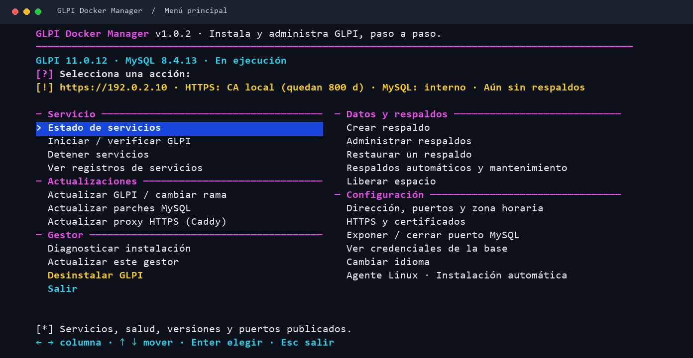

**Español** | [English](README.en.md)

# GLPI Docker Manager

Gestor interactivo para instalar y administrar GLPI en Linux mediante imágenes
oficiales de Docker. La interfaz está disponible en español e inglés; el código y
la documentación técnica principal están en inglés.

Versión **1.0.2**. Los [resultados y límites de validación](docs/validation.md)
registran 26 grupos aprobados, ShellCheck sin avisos y pruebas desechables de
instalación, actualización y restauración en Docker el 2026-10-19. No certifican
todas las distribuciones, plugins ni versiones futuras.



*Menú principal en español, capturado con datos de demostración.*

## Inicio rápido

```bash
git clone https://github.com/solqubit/glpi-docker-manager.git
cd glpi-docker-manager
chmod +x start.sh
sudo ./start.sh
```

La instalación y administración requieren sudo/root. Sin esos permisos se muestra
una alerta y el comando exacto antes de modificar el sistema. `help` y `version`
funcionan sin privilegios. El asistente detecta dependencias y ofrece
instalar Docker Engine, Compose y las herramientas necesarias con confirmación.
Si Docker ya funciona, lo reutiliza.

Si el motor está detenido, inicia su servicio mediante systemd, OpenRC o service
según lo disponible y continúa. Ofrece instalar Compose/Buildx desde repositorios
apt/dnf/yum ya configurados. Si una operación de servicio o paquetes falla, muestra
instrucciones y permite reintentar dentro del asistente.

Durante la instalación eliges idioma, rama y versión de GLPI, puertos,
zona horaria, credenciales y HTTPS. El selector consulta versiones estables e
imágenes oficiales, incluidas futuras ramas como GLPI 13. Muestra las tres
versiones instalables más recientes por rama; también admite una versión exacta.
Las comprobaciones oficiales de requisitos deben pasar para instalar o migrar.

Antes de confirmar verás las notas oficiales y avisos de seguridad. El selector de
instalación nueva muestra GLPI 10 al final, marcado como rama sin soporte (para
plugins aún no compatibles o ensayos de migración); también funcionan
`install 10.x.y` y restaurar un respaldo, siempre con advertencia y confirmación.
Volver a ejecutar el gestor
abre el menú y conserva los datos y contraseñas existentes.

## Interfaz de terminal

Utiliza **↑ / ↓** para recorrer opciones, **Enter** para elegir y **Esc** para
cancelar o salir de un menú. El idioma, las ramas/versiones, HTTPS y
las confirmaciones se eligen mediante selectores. La configuración permanece en
una sola sección: eliges un campo, lo editas y regresas al mismo campo con el
valor guardado. Se marcan los valores por defecto, los campos validados y las
contraseñas pendientes. La zona horaria ofrece listas buscables de región y
ciudad. Los puertos, dominio y credenciales permiten escribir y editar texto.
Desde la revisión puedes regresar y corregir cualquier dato.

La primera pantalla distingue si aún no hay GLPI, si existe una instalación o si
quedó una operación pendiente. Antes de instalar verás un resumen sin contraseñas.
Después aparecen ocho etapas con su avance y el mensaje verde **GLPI instalado y
verificado**, la URL y los datos del primer acceso. El éxito se muestra después de
comprobar servicios, SQL, esquema y HTTP/HTTPS.

Los mensajes comparten un mismo estilo de marcadores: `[+]` éxito, `[*]`
información, `[!]` aviso, `[✗]` error y `[?]` pregunta. Las etapas largas muestran
un indicador animado con el tiempo transcurrido y el detalle actual (imagen que se
descarga, salud de un servicio, intento de comprobación web). La lista de
versiones de GLPI se guarda 15 minutos y las imágenes se consultan en paralelo, de
modo que las pantallas de versiones y actualización abren mucho más rápido.

El panel agrupa las acciones por categoría y muestra HTTPS y los días que le
quedan al certificado, si MySQL está expuesto, el último respaldo y la
programación de respaldos automáticos. Una tarea diaria (temporizador systemd o
cron) rota los registros, renueva los certificados autofirmados y puede crear
respaldos automáticos (se guardan los 5 más recientes; los manuales nunca se
rotan). El gestor también muestra la caducidad del certificado, desinstala GLPI
de forma limpia y se actualiza desde las versiones publicadas en GitHub (o con
`git pull --ff-only` al ejecutarlo desde un clon). La
configuración propia de GLPI (correo, plugins, acciones automáticas) se hace en
GLPI.

Las notas completas de una versión pueden abrirse desde el selector; los avisos
de seguridad y soporte se muestran siempre. El detalle de instalación se guarda
en registros privados y se indica su ruta si una etapa falla. Hay un modo sencillo
numerado para terminales básicas; `NO_COLOR` conserva las flechas sin colores.

Siempre se instala el mismo GLPI: no hay una clasificación de pruebas/producción.
La advertencia de recursos permite continuar o volver directamente al menú.
El resumen muestra los valores en una tabla, y la opción de MySQL explica que
publicar el puerto 3306 permite conexiones externas. Para una VPS con dominio,
HTTPS público solicita y renueva certificados de **Let's Encrypt** mediante Caddy.

## Qué puedes administrar

* Instalación automática del agente Linux desde un comando para cada equipo:
  configura HTTP, HTTPS público o CA local, envía el primer inventario y activa
  su servicio. Habilitada por defecto y administrable desde el menú, sin pasos
  nuevos en el asistente. [Guía del agente Linux](docs/linux-agent.md).
* Estado, inicio, parada, registros y diagnóstico.
* Un solo menú para actualizar GLPI: elegir cualquier versión posterior disponible
  de la misma rama, o la siguiente rama con advertencias y confirmación explícita.
* Respaldo y ensayo aislado antes de aplicar cada cambio de versión.
* Publicación de MySQL con Sí/No: exactamente `3306:3306`, configurable después.
* HTTPS autofirmado generado automáticamente, certificado público con renovación
  ACME o certificados propios, al instalar o posteriormente.
* Respaldos de base, archivos, plugins, claves, configuración y certificados.
* Restauración guiada a volúmenes nuevos y traslado a otro servidor.
* Consulta de credenciales bajo confirmación y mantenimiento independiente de
  parches MySQL dentro de la serie 8.4.
* Memoria de MySQL (buffer pool) calculada según la RAM del servidor (25 %, de
  256 MiB a 8 GiB) y recalculada cada vez que se regenera la configuración.
* `proxy-update` aplica la última imagen de Caddy 2 (proxy HTTPS); si HTTPS no
  responde, vuelve la configuración anterior. El mantenimiento diario solo avisa
  en el menú principal de imágenes nuevas de GLPI, MySQL y Caddy; nunca las aplica.
* Imágenes de GLPI, MySQL y Caddy fijadas por versión exacta y digest del registro.
* Respaldos programados diariamente, cada 2/3/N días (hasta 30), de lunes a
  viernes o en días elegidos, con horario y vista de las próximas ejecuciones.
  Las listas distinguen `[M]` manuales (no se rotan), `[P]` previos a actualizar
  o restaurar (se conservan los 3 más recientes) y `[A]` automáticos (los 5 últimos).
* Retención configurable de registros del gestor y GLPI, límites de registros de
  contenedores y retención de logs binarios de MySQL. La limpieza muestra tamaños
  y ofrece recursos sin uso administrados por el gestor.
* Registro de operaciones pendientes, bloqueo entre procesos y revisiones de
  configuración para guiar la recuperación cuando una operación se interrumpe.

## Comandos útiles

```bash
./start.sh --lang es help
sudo ./start.sh status
sudo ./start.sh check-updates
sudo ./start.sh update
sudo ./start.sh update 11.0.11   # versión posterior exacta
sudo ./start.sh migrate 12.0.0   # migración a la siguiente rama
sudo ./start.sh backup
sudo ./start.sh backups
sudo ./start.sh restore
sudo ./start.sh restore /ruta/absoluta/respaldo.tar.gz
sudo ./start.sh https
sudo ./start.sh address
sudo ./start.sh db-exposure
sudo ./start.sh credentials
sudo ./start.sh transfer
sudo ./start.sh certificates     # modo HTTPS, caducidad, renovación y recarga
sudo ./start.sh schedule         # respaldos automáticos y mantenimiento diario
sudo ./start.sh cleanup          # liberar espacio
sudo ./start.sh self-update      # actualizar este gestor
sudo ./start.sh uninstall
sudo ./start.sh diagnose
sudo ./start.sh recover
```

En el menú, *Actualizar GLPI* incluye también `check-updates` y `refresh-image`,
*Crear respaldo* ofrece el respaldo de traslado (`transfer`) y *HTTPS y
certificados* permite cambiar el modo HTTPS.

Sin comandos se abre el menú interactivo. Las operaciones sensibles solicitan
confirmación. Las restauraciones y migraciones principales requieren escribir una
confirmación específica. También están disponibles `start`, `stop`, `logs`,
`db-update`, `proxy-update`, `refresh-image`, `language`, `maintenance` (tarea diaria) y `version`.
No existe una opción general `--yes` para omitir las confirmaciones.

## Datos y credenciales

La configuración privada está en `/opt/glpi-docker-manager`, fuera del
repositorio. Toda la instalación queda reunida en esa carpeta:

```text
/opt/glpi-docker-manager/
├── start.sh                 # abrir el gestor instalado
├── manager/                 # código operativo, idiomas y documentación
├── manager-releases/        # revisiones del código del gestor
├── current/                 # configuración activa, .env y Compose
├── revisions/               # revisiones de configuración
├── data/<id>/               # datos reales de GLPI, MySQL, plugins y proxy
├── certs/                   # certificados y claves
├── backups/                 # respaldos disponibles para restaurar
├── logs/                    # registros de las operaciones
├── cache/                   # metadatos de versiones
├── maintenance.json         # programación y ajustes de registros
├── history.jsonl            # operaciones completadas, sin contraseñas
└── operation.json           # solo si hay una operación pendiente
```

Después de instalar puedes abrirlo con:

```bash
sudo /opt/glpi-docker-manager/start.sh
```

El código se copia dentro de esa raíz; la carpeta descargada de GitHub ya no es
necesaria para administrar GLPI. Ejecutar una copia nueva del repositorio actualiza
el código operativo sin reemplazar datos ni credenciales. Docker monta las carpetas
de `data/` mediante volúmenes etiquetados; no se eliminan durante actualizaciones.
Las imágenes y los componentes del motor Docker siguen administrados por Docker
en el sistema. Los respaldos contienen
secretos y el gestor no los cifra: guarda una copia privada fuera del servidor
mediante transporte y almacenamiento cifrados.

`--state-dir /ruta/absoluta` permite elegir otra raíz completa; úsala siempre
para esa instalación. Cada raíz tiene datos y un identificador independientes;
dos instalaciones no pueden publicar los mismos puertos del servidor. Las
carpetas privadas usan permisos 0700 y los archivos secretos 0600. Quien administra
Docker también puede inspeccionar las variables de los contenedores.

Las claves de MySQL se generan o se introducen durante el asistente. Son distintas
de las cuentas web iniciales de GLPI: `glpi/glpi`, `tech/tech`, `normal/normal` y
`post-only/postonly`. Cambia estas cuentas desde GLPI. Editar `.env` por sí solo no
cambia la contraseña ya almacenada en MySQL.

Puedes conservar los valores habituales (`db:3306`, base y usuario `glpi`) o
personalizarlos. HTTP utiliza 80 y HTTPS 443 por defecto para abrir GLPI con la
IP sin escribir el puerto; puedes cambiarlos si están ocupados. Se detecta la IP
de la interfaz de red principal. `address` permite corregir IP, puertos, zona
horaria y HTTPS de una instalación existente. El asistente genera `.env`; elige tus
`GLPI_DB_PASSWORD` y `MYSQL_ROOT_PASSWORD`, sin longitud ni complejidad mínima.
Se ven mientras escribes y Tab permite ocultarlas o mostrarlas. Al aceptar se
borra el campo; dejarlo vacío genera una contraseña automáticamente. La interfaz
utiliza colores ANSI y el módulo opcional `curses` de Python, sin paquetes de pip;
si no está disponible, ofrece opciones numeradas. En una terminal de 80×24 el menú
principal muestra todas las acciones en dos columnas. Estado y registros tienen
vistas propias para evitar tablas extensas debajo del menú.

Los respaldos previos a actualizar aparecen en **Restaurar un respaldo** y
**Administrar respaldos**. Allí puedes consultar detalles, verificar integridad,
exportar una copia o eliminar un archivo concreto escribiendo `DELETE`.
Para restaurar, elige el archivo y confirma escribiendo `RESTORE`:
se recuperan la versión y los datos de ese momento en volúmenes nuevos. Los
cambios posteriores al respaldo no se fusionan. Reducir el número de la imagen
por sí solo no revierte una migración de base de datos.

Antes de generar un respaldo, el gestor estima los datos y el espacio temporal
necesario y los compara con el espacio disponible. Solo después detiene GLPI.
La actualización comprueba además el espacio para el ensayo y las imágenes que
faltan: no exige una reserva fija de 10 GiB. Un respaldo manual y uno previo a
actualizar se identifican por separado en la interfaz.

La contraseña de la aplicación admite comillas, dólares y barras invertidas.
La contraseña de administrador de MySQL excluye comillas y barras invertidas por
el procedimiento inicial de la imagen oficial; el asistente lo explica y puede
generar una contraseña segura automáticamente.

Los certificados importados deben estar exactamente en:

```text
/opt/glpi-docker-manager/certs/custom/fullchain.pem
/opt/glpi-docker-manager/certs/custom/privkey.pem
```

`fullchain.pem` contiene el certificado del dominio seguido de sus intermedios;
`privkey.pem` contiene la clave privada PEM correspondiente sin contraseña. El
asistente comprueba formato, coincidencia, dominio y caducidad.

El modo autofirmado genera una **CA local de 20 años** y certificados de servidor
de **825 días**, renovados 30 días antes de caducar cuando se ejecuta el
mantenimiento programado. Distribuye únicamente este certificado público:

```text
/opt/glpi-docker-manager/certs/self-signed/ca/gdm-ca.pem
```

También se descarga en `http://SERVIDOR/gdm-ca.pem` (añade el puerto HTTP si no es
80). Antes de confiar en él, compara su huella SHA-256 con la pantalla **HTTPS y
certificados**. En el instalador de GLPI Agent, indica la ruta de la copia local
en **CA Certificate File**, deja vacíos **CA Certificates Directory** y
**Fingerprint**, y mantén activa la verificación SSL. Los navegadores deben
confiar en esa CA como autoridad raíz; en Active Directory puede distribuirse
mediante GPO. No fijes la huella del certificado de servidor: cambia al renovarse.

La renovación conserva la CA y no exige reconfigurar los agentes. Reemplazarla o
su caducidad sí exige distribuir la nueva CA. Nunca distribuyas `gdm-ca.key` ni la
clave privada del servidor. Los respaldos incluyen la CA y su clave para mantener
la confianza tras restaurar. Consulta los [ejemplos de agentes y HTTPS](docs/https.md).
Los certificados públicos de Let's Encrypt utilizan la confianza pública habitual;
los importados deben renovarse externamente y recargarse desde el gestor.

## Compatibilidad y precauciones operativas

Una distribución fuera de la lista puede funcionar si cumple los requisitos.
La [matriz de compatibilidad](docs/compatibility.md) distingue procedimientos de
instalación de Docker y pruebas realizadas. No se inventan repositorios para una
distribución desconocida. Se verifican las imágenes para AMD64 y ARM64.

Una actualización de GLPI puede migrar sus tablas; una actualización de MySQL
cambia el motor. Son operaciones independientes. Volver a una imagen anterior no
garantiza recuperar datos después de una migración. Las restauraciones verifican
el respaldo y crean volúmenes vacíos. Primero se respalda la instalación en
ejecución (`[P]`); al verificar la restauración se elimina esa instalación
reemplazada. Si no pudo respaldarse, queda detenida como punto de retorno.

Las nuevas ramas se descubren automáticamente, pero deben superar las
comprobaciones de imágenes y requisitos. Si necesitan otra serie de MySQL, hará
falta actualizar la compatibilidad del gestor: no automatiza saltos de 8.4 a 9.x.

Si se interrumpe una operación, consulta los registros y utiliza `recover` o
restaura un respaldo válido. El ensayo de migración comprueba el esquema, pero
debes revisar plugins, integraciones e inventario y probar tus procesos habituales.

Consulta también [HTTPS](docs/https.md), [respaldos y recuperación](docs/data-operations.md)
y [solución de problemas](docs/troubleshooting.md). La licencia del gestor es MIT;
los componentes conservan sus licencias originales.

## Pruebas locales

Los [resultados de validación](docs/validation.md) detallan las pruebas locales y
sus límites. Las validaciones se ejecutan localmente con Docker, servicios
desechables y credenciales de prueba. No se incluye ningún workflow de GitHub Actions.
